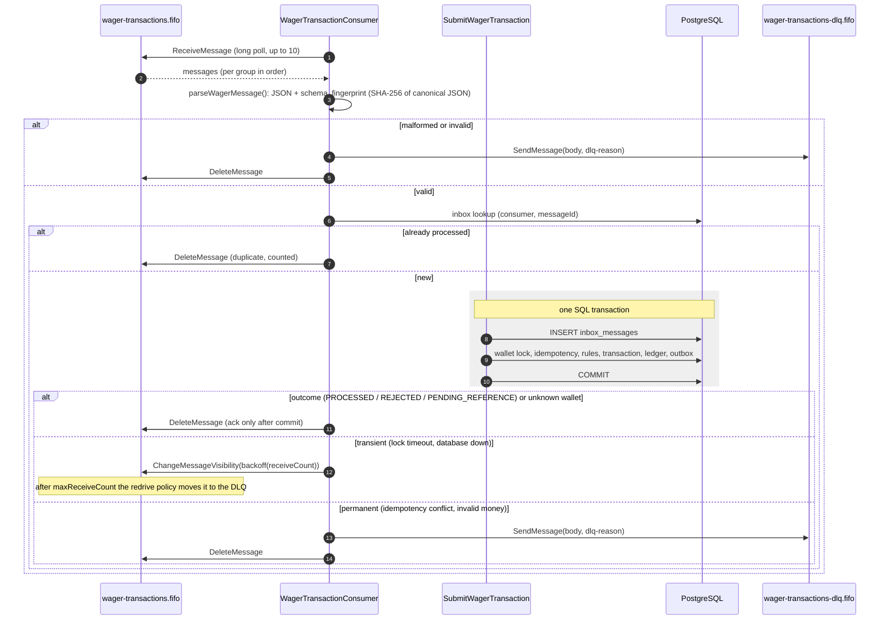

# Consuming a wager from SQS

Why: SQS delivers at least once and a consumer can die at any step. A message must change the wallet once,
and failures must split into done (ack), try again later (retry) and needs a human (DLQ).

Source: `src/modules/wagering/interface/sqs/wager-transaction-consumer.ts` (ADR-0010).

## Failure scenarios

| Scenario                                   | Outcome                                                                               |
| ------------------------------------------ | ------------------------------------------------------------------------------------- |
| Same message delivered twice               | The inbox row exists: acked, counted as a duplicate, no second effect                 |
| Crash after commit, before `DeleteMessage` | Visibility expires, the message returns, the inbox recognises it, acked               |
| Two consumers get the same message         | One commits; the other fails on `inbox_messages_pkey`, treats it as a duplicate, acks |
| Same `messageId`, different content        | Dead-lettered as `MESSAGE_ID_REUSED`                                                  |
| PostgreSQL down / wallet lock held         | Retried with exponential visibility backoff; dead-lettered by the redrive policy      |
| `SIGTERM`                                  | Polling stops, in-flight messages finish, received-but-unstarted ones are released    |
