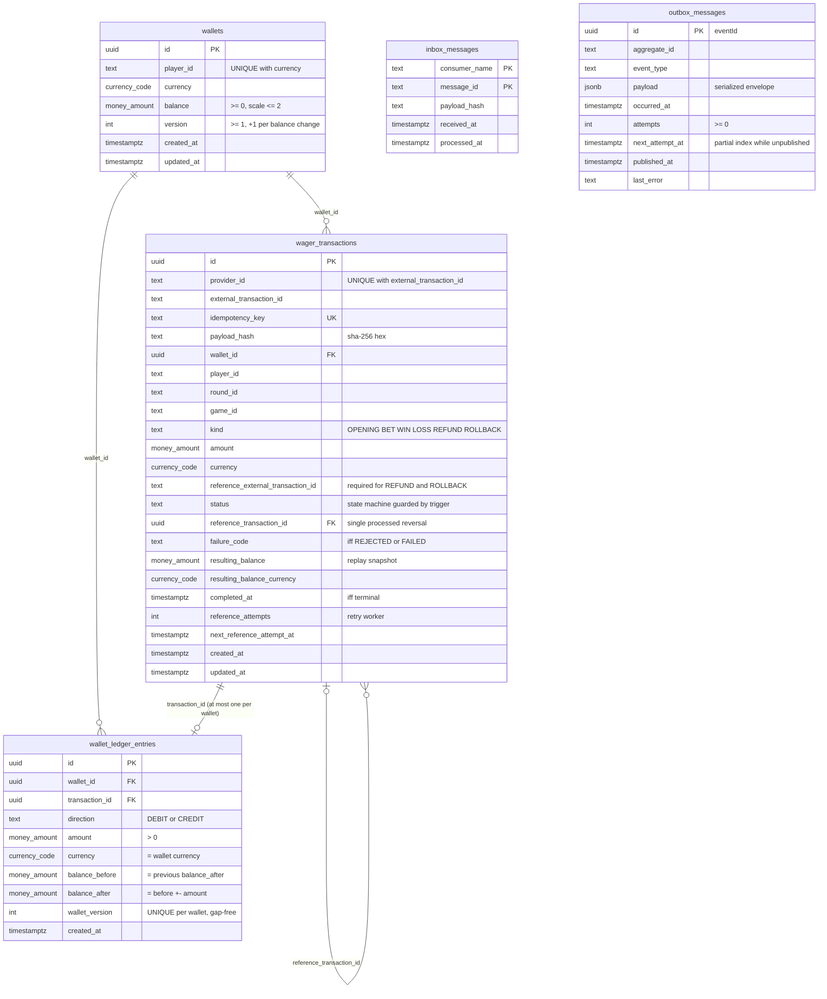
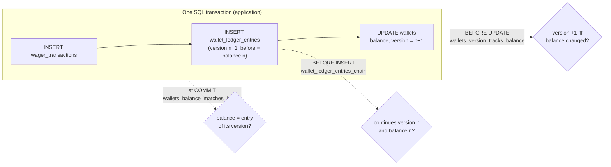

# Data model

Source of truth: `src/infrastructure/database/migrations/`. Guarantees: ADR-0006.

## How balance and ledger stay locked together

## Indexes beyond primary keys and uniques

| Index                                          | Purpose                                                    |
| ---------------------------------------------- | ---------------------------------------------------------- |
| `wager_transactions_single_reversal_idx`       | Unique: one processed REFUND/ROLLBACK per reference        |
| `wager_transactions_wallet_idx`                | Foreign-key checks and per-wallet queries                  |
| `wager_transactions_pending_reference_due_idx` | Retry worker: due `PENDING_REFERENCE` rows                 |
| `wager_transactions_waiting_on_reference_idx`  | Nudge dependents when their reference arrives              |
| `wallet_ledger_entries_wallet_version_key`     | Unique chain key; also the stable ledger pagination cursor |
| `outbox_messages_due_idx`                      | Relay claims: unpublished rows by `next_attempt_at`        |

## Roles

| Role                | Privileges                                                                                                          |
| ------------------- | ------------------------------------------------------------------------------------------------------------------- |
| `wagering_migrator` | Owns the schema; runs migrations; `CREATEDB` for test databases                                                     |
| `wagering_app`      | `SELECT, INSERT, UPDATE` on wallets, transactions, inbox, outbox; ledger `SELECT, INSERT` only; no DDL, no `DELETE` |
