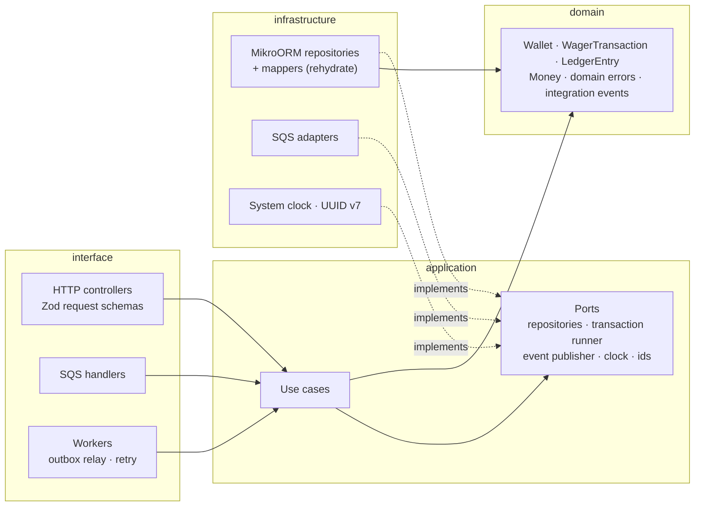
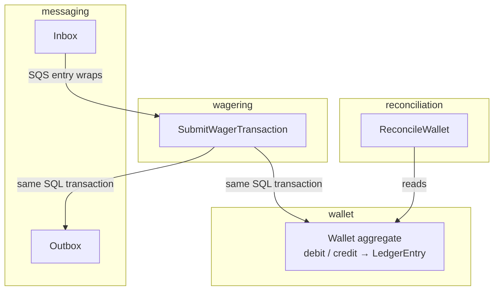

# Module structure

## Layers and the dependency rule (ADR-0003)

Arrows point from a layer to what it depends on. The domain depends on nothing; adapters implement ports.



## How the modules collaborate



`SubmitWagerTransaction` is the single write path for wagers. The HTTP controller and the SQS handler both
call it. Inside one transaction it locks the wallet, applies the movement through the `Wallet` aggregate
(which produces the ledger entry), persists the transaction outcome and appends the outbox events. On the
SQS path, it also records the inbox row.

## Source layout

```text
src/
  main.ts                 role-based bootstrap (APP_ROLES)
  app.module.ts
  bootstrap/              HTTP application factory, worker runners
  config/                 environment validation → typed AppConfig
  shared/                 shared kernel: Money, base errors, Clock / IdGenerator ports
  infrastructure/         cross-cutting adapters
    database/             MikroORM options, migrations (hand-written SQL, up/down)
  modules/
    health/               liveness / readiness
    wallet/               domain · application · infrastructure · interface
    wagering/             domain · application · infrastructure · interface
    messaging/            inbox, outbox, relay
    reconciliation/       ledger vs balance check
test/
  unit/ integration/ e2e/ concurrency/ load/ support/
scripts/                  migrate, sqs-bootstrap, check-focused-tests
docker/                   Postgres init (roles and databases)
docs/                     ADRs, diagrams, plan, traceability, challenge
```
