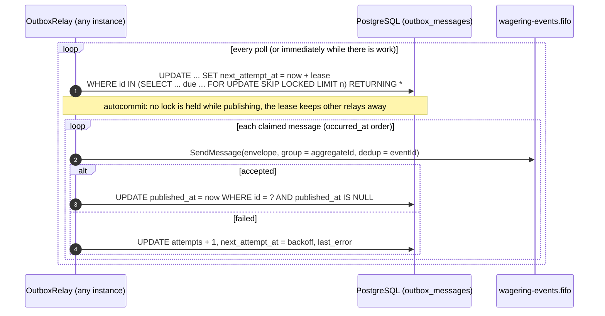

# Publishing outbox events

Source: `src/modules/messaging/application/outbox-relay.ts`, `src/infrastructure/database/mikro-orm-outbox-store.ts`
(ADR-0011).

## Crash and concurrency scenarios (§11)

| Scenario                                               | What happens                                                                                           |
| ------------------------------------------------------ | ------------------------------------------------------------------------------------------------------ |
| Commit, then the process dies before publishing        | The row stays unpublished; after the lease expires another relay claims and publishes it               |
| Published, then the process dies before `published_at` | Republished after the lease; SQS FIFO dedup may drop it, and consumers deduplicate by `eventId` anyway |
| Two relays poll at the same time                       | `SKIP LOCKED` + lease: each row is claimed by one relay; nothing is lost                               |
| Broker unavailable                                     | `attempts` / `last_error` recorded, retried with exponential backoff (1 s → 5 min)                     |
| Transaction rolled back                                | Its outbox rows never existed: nothing to publish                                                      |
