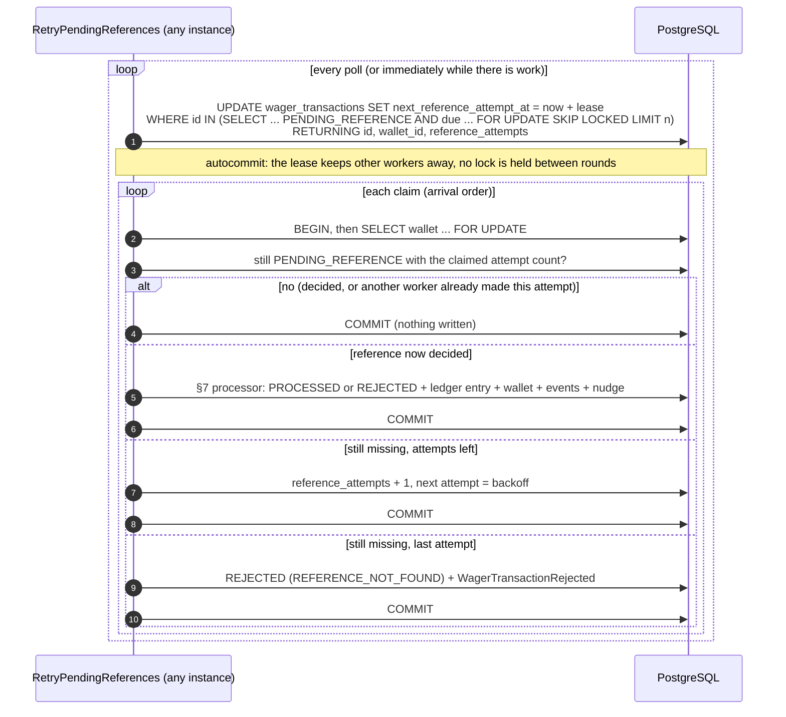

# Resolving a pending reference

Source: `src/modules/wagering/application/retry-pending-references.ts`,
`src/infrastructure/database/mikro-orm-pending-reference-queue.ts` (ADR-0012).

A `REFUND` or `ROLLBACK` whose reference has not arrived is stored as `PENDING_REFERENCE` (HTTP 202, SQS ack),
with retry 1 due one second later. When the referenced transaction is decided, the same SQL transaction nudges
every row waiting on it, so they become due at once.

## Schedule (defaults, every value configurable)

| Attempt | Wait before it | Elapsed since arrival |
| ------- | -------------- | --------------------- |
| 1       | 1 s            | 1 s                   |
| 2       | 2 s            | 3 s                   |
| 5       | 16 s           | 31 s                  |
| 9       | 256 s          | 8 min 31 s            |
| 10      | 300 s (cap)    | 13 min 31 s           |

After attempt 10 the transaction is `REJECTED` with `REFERENCE_NOT_FOUND`. It gets `REFERENCE_NOT_PROCESSED`
instead when the reference exists but never settled.

## Crash and concurrency scenarios

| Scenario                                           | What happens                                                                                   |
| -------------------------------------------------- | ---------------------------------------------------------------------------------------------- |
| Two workers poll at the same time                  | `SKIP LOCKED` + lease: each row is claimed once; rows of one wallet are serialized by its lock |
| A worker dies before commit                        | Nothing was written; the lease expires and another worker makes the same attempt               |
| A slow worker resumes after its lease expired      | Its claimed attempt count no longer matches, so it skips: each attempt is counted once         |
| The reference arrives while the row is backing off | The nudge makes it due immediately; the next round resolves it                                 |
