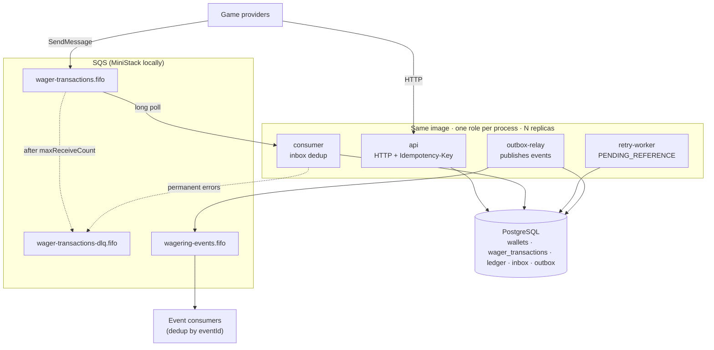

# Runtime topology

One container image runs as several processes, each with a role selected by `APP_ROLES` (ADR-0001).
They share one PostgreSQL database and coordinate only through it and SQS.

## Roles

| Role           | Entry                     | Reads / writes                                                                                 | Scales by                       |
| -------------- | ------------------------- | ---------------------------------------------------------------------------------------------- | ------------------------------- |
| `api`          | HTTP                      | Wallets, transactions, ledger, outbox (one SQL transaction per request)                        | Replicas behind a load balancer |
| `consumer`     | `wager-transactions.fifo` | Same use case as `api`, plus the inbox, in one transaction; ack after commit                   | Replicas (competing consumers)  |
| `retry-worker` | Schedule                  | Claims due `PENDING_REFERENCE` rows with `SKIP LOCKED`                                         | Replicas (claims never overlap) |
| `outbox-relay` | Schedule                  | Claims unpublished outbox rows with `SKIP LOCKED` + lease, publishes to `wagering-events.fifo` | Replicas (claims never overlap) |

## One-shot services (Docker Compose)

| Service     | Purpose                                                              |
| ----------- | -------------------------------------------------------------------- |
| `migrate`   | Applies migrations with the schema-owner role before any role starts |
| `sqs-init`  | Creates the three queues and the redrive policy (idempotent)         |
| `workspace` | Tooling container: install, lint, typecheck, all test suites         |
