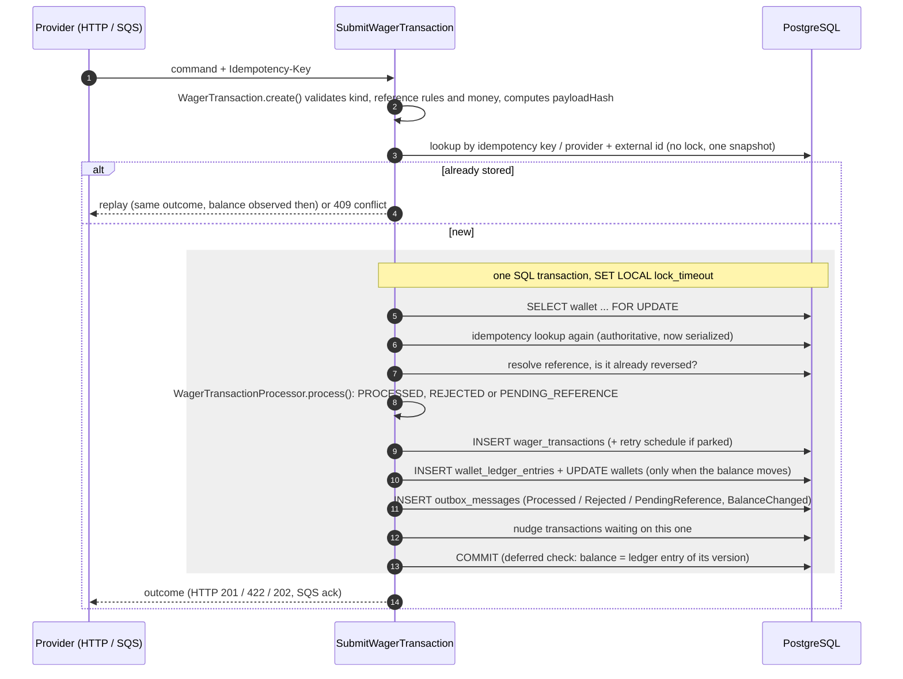

# Submitting a wager

Source: `src/modules/wagering/application/submit-wager-transaction.ts`. The same use case serves HTTP and
SQS (§10).

## Concurrency outcomes

| Situation                                     | What happens                                                                                               |
| --------------------------------------------- | ---------------------------------------------------------------------------------------------------------- |
| Two bets on the same wallet                   | The second waits on the row lock, then sees the new balance (§8 scenario)                                  |
| 50 copies of the same bet                     | One processes; the others replay, from the fast path or after the lock                                     |
| Same key, different wallets, at the same time | Different rows are locked; the unique index rejects the loser, which retries once and replays or conflicts |
| Two reversals of one BET with different keys  | Serialized by the wallet lock; the second is `ALREADY_REVERSED` (the partial unique index backs it up)     |
| Lock held longer than `lock_timeout`          | `TransientInfrastructureError(LOCK_TIMEOUT)`: HTTP 503 / SQS retry, counted as a lock conflict             |
| Any failure before commit                     | Nothing is written: no transaction, entry, balance change or event                                         |
