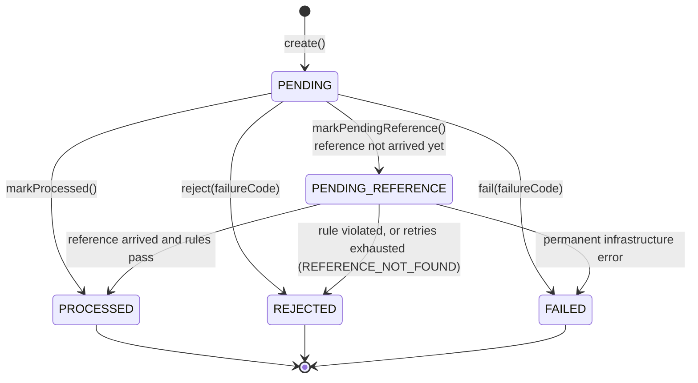
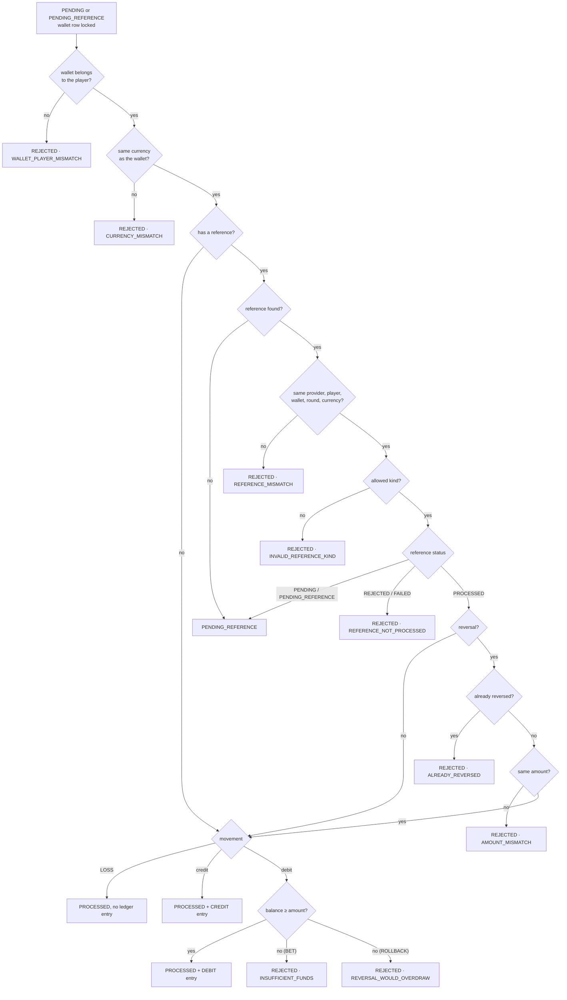

# Wager transaction lifecycle and rules

Why: §7 defines what each kind may do and in which order the rules apply. The state machine makes sure a
decided transaction never changes again.

Source: `src/modules/wagering/domain/wager-transaction.ts` and `wager-transaction-processor.ts`.

## State machine (§6.3)

- `PROCESSED`, `REJECTED` and `FAILED` are terminal. Any further transition throws
  `InvalidTransactionStateError`, because it is a programming error, not a business path.
- `OPENING` is created directly as `PROCESSED` by `WagerTransaction.opening()`, inside the same SQL
  transaction as the wallet. It is never submitted.
- Every decision stores the balance observed at that moment (`resultingBalance`), so a replay returns the
  original outcome (§7 rule 7).

## Decision order in the processor

## Rules per kind (§7)

| Kind     | Reference                            | Movement                                    | Ledger                     |
| -------- | ------------------------------------ | ------------------------------------------- | -------------------------- |
| BET      | Forbidden                            | Debit; `INSUFFICIENT_FUNDS` if not covered  | 1 `DEBIT`                  |
| WIN      | Optional, must be the round BET      | Credit                                      | 1 `CREDIT`                 |
| LOSS     | Optional, must be the round BET      | None (amount may be 0.00)                   | None                       |
| REFUND   | Required, a processed BET            | Credit of the same amount, once             | 1 `CREDIT`                 |
| ROLLBACK | Required, a processed BET/WIN/REFUND | Inverse of the reference, same amount, once | 1 entry, inverse direction |
| OPENING  | Internal only                        | Credit of the initial balance               | 1 `CREDIT`                 |
